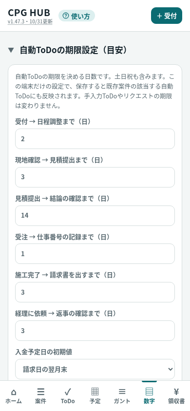

# PR #49：v1.47.3 文言変更の検証記録

2026-10-31 JST。作業開始時の基準はv1.47.2、main `5b4e4e636dd024efb4c124f48cee3df9d3204223`。
既存branch `codex/todo-deadline-label` にmainを通常mergeし、旧headの履歴を維持。rebase・force pushなし。

通常merge commit: `8c572b5d2b372d9fcf78db4edc3c72939a867546`
親: `5aceccdecb7e28f33527ea669df76aac218310cb` / `5b4e4e636dd024efb4c124f48cee3df9d3204223`

競合したindex・manual・READMEは最新mainを基準に解決し、元PRの見出し・説明を再適用。既存の開閉式設定欄とv1.47.2リクエスト表示を維持する。旧候補v1.47の履歴はgitと改訂履歴の説明に保持。

## 確認

- index全文は、mainに対し見出し・説明・版表示・manual参照だけの置換と完全一致（assert）。CSS、日数、期限計算、保存・同期・権限・リクエスト表示は無変更。
- 同じ合成案件・手入力ToDo・I系指示で基準mainとv1.47.3を比較。設定初期値、変更後の日数（schedule=5、quote=6）、genTodos結果、保存JSON、再読込結果が一致。
- 390×844の実Chromium描画で横はみ出しなし、説明全文が画面内に表示。合成データのみ。下記画像を目視確認。
- `node tests/*.cjs` はシェルglobを1回渡す意味ではなく、各ファイルを個別にnodeで実行。最終27本すべてexit 0、失敗0。git diff --checkも成功（calendar-privacy／takeover aggregate、request-compact 7項目を含む）。
- Android実機・実Googleは未検証。Libraryは前回の接続エラー後に同じ条件で再試行せず、GitHubのcommit固定画像を提供する。
- 実装・検証時にはPR更新までを担当し、merge・公開・auto-merge・Approveレビューは行っていない。以後の実施状況はPR #49とPagesの履歴を参照。公開にはトシの明示承認が必要。

