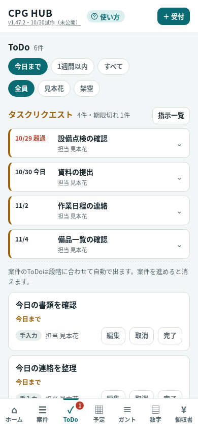
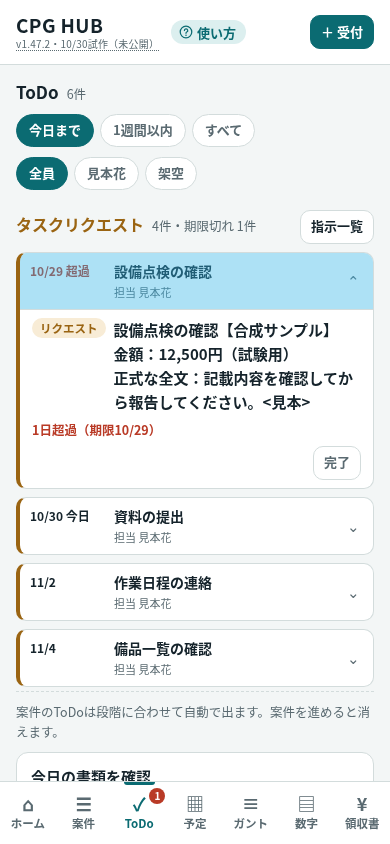
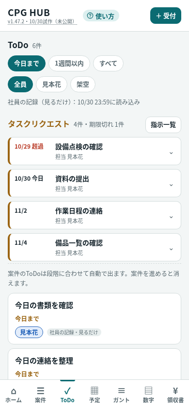
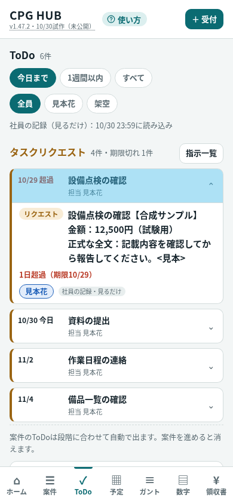
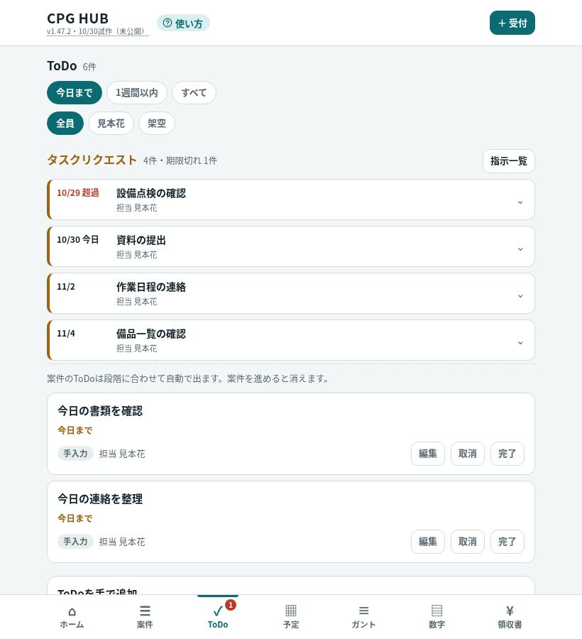
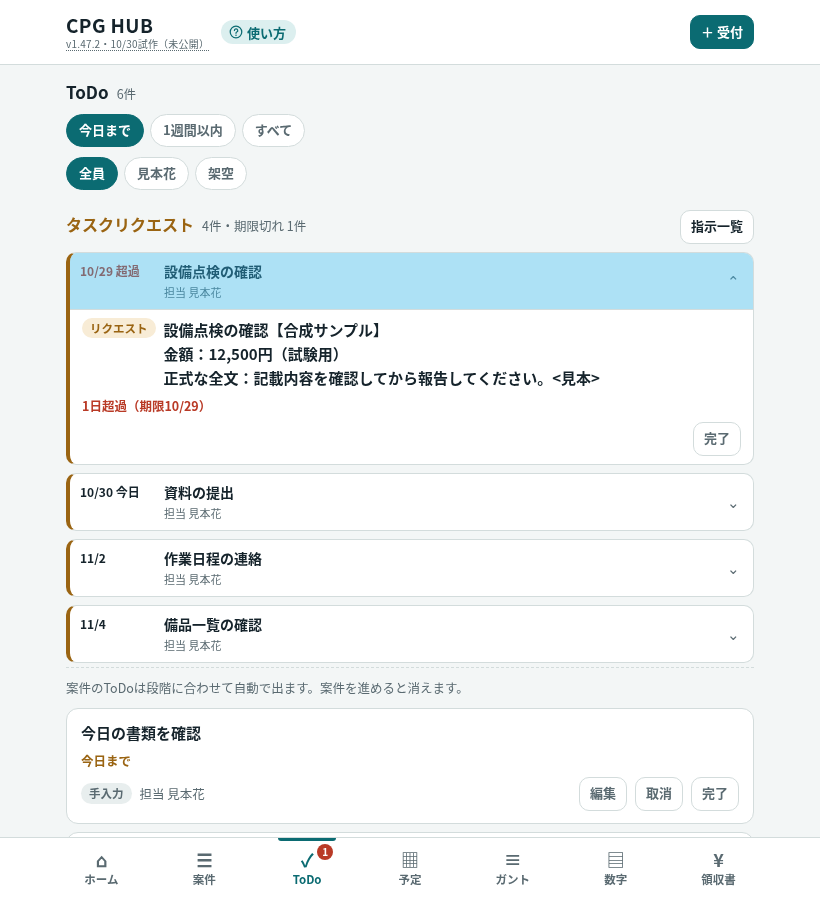
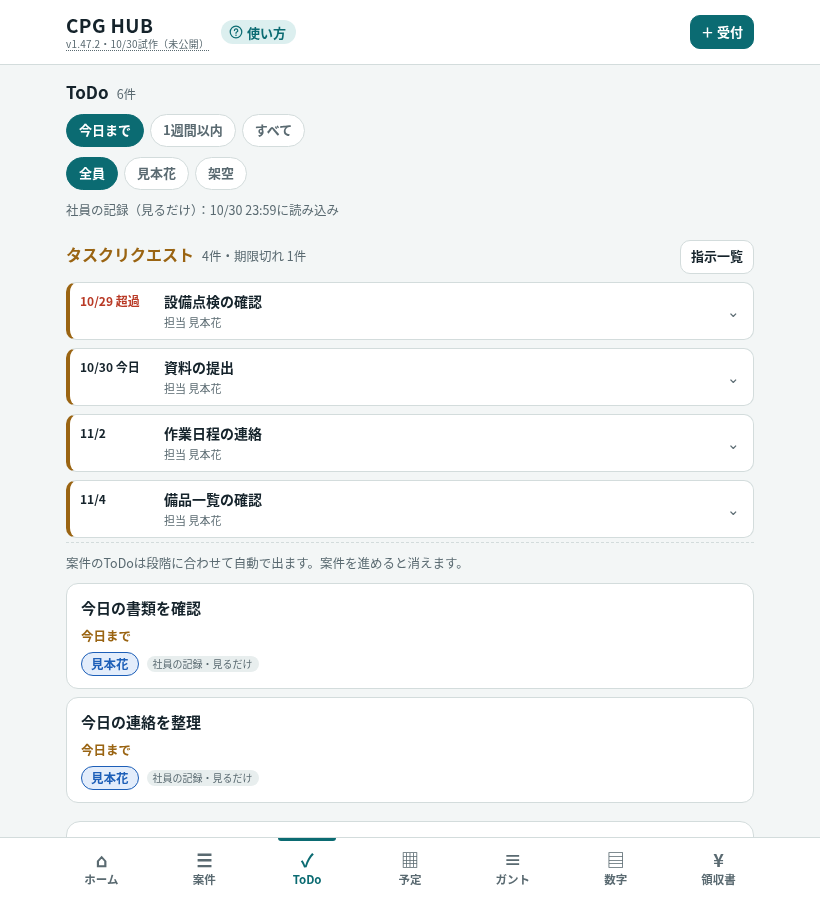
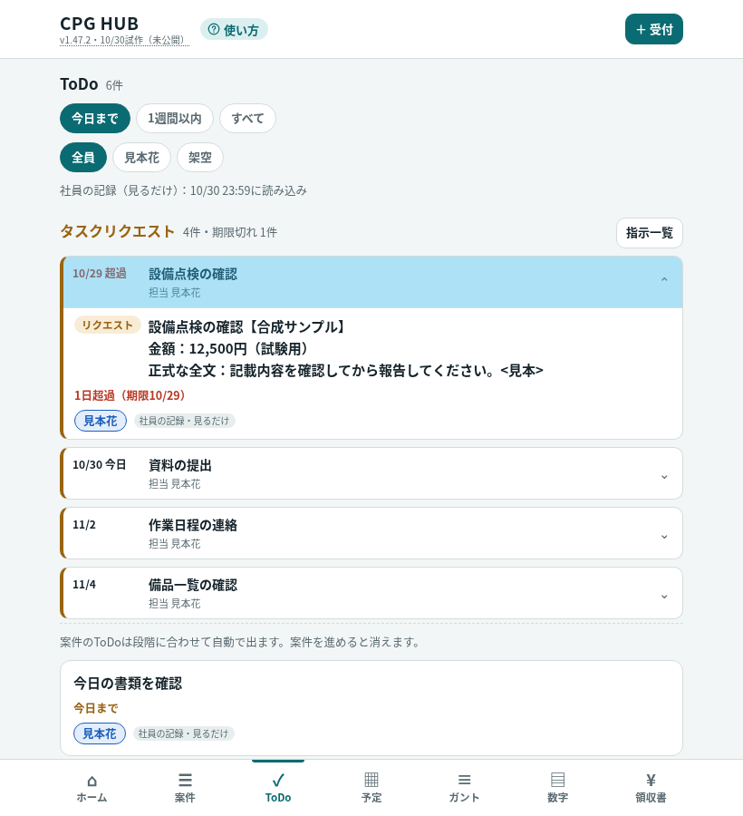

# リクエスト表示試作 v1.47.2（未公開）

2026-10-30 JST。基準main: `22570158b25939fb04bb350e62bc4432fcea8ddf`（公開済みv1.47.1）。
branch: `codex/request-compact-preview`。Draft PRでスマホ幅を確認する試作。merge・公開は未承認。

## 表示と保存の境界

- 代表I系・指示箱B系、社員・管理側readonlyとも通常ToDoより上。JST今日＋5日までの未完了と期限切れだけを、期間ボタンにかかわらず表示。
- ＋6日以降の折りたたみは廃止。期限なしは「だけ」という条件に合わせToDoから除外し、先の期限とともに「指示一覧」で確認する。指示を消さない。既存の管理者指示箱一覧は維持。
- 要約は先頭行の【より前、最大26文字。表示だけで、開くと元の全文・金額・既存の完了操作を表示。閲覧のみのものは操作不可。再タップで閉じる。
- 元データ・保存形式・共有出力・同期・報告・状態優先順位は不変。既存の名前付き関数ブロックの比較では表示関数だけが変更。request-box-employee.js、manifestも無変更。ホームの今日ToDoも同じ小型カードにし、指示を先に並べる（ホームの期限範囲・6件上限は維持）。
- PR #49は数字画面の期限設定文言。この試作は最新mainから独立し、取り込まず変更しない。共通の版文字列・文書履歴は将来の統合時に整理する。

## 確認画像（すべて合成）

390×844 CSS px。社員／全社の閉じた状態で通常の今日ToDoが画面内に出る。1件開くと全文分だけ下へ延びる。

| 表示 | 閉じる | 1件開く |
| --- | --- | --- |
| 社員 |  |  |
| 全社readonly |  |  |

820×900 CSS pxは開いたFold相当の参考エミュレーションであり、Fold8実機のCSS寸法と断定しない。スクロール0で閉じた状態は両方とも通常ToDoが2件見える。開いた状態も最初の通常ToDoカード全体が両方で見える。詳細内の重複した上下余白を計8px削減。カード下端は社員823.53px／全社833.53px、固定ナビ上端837pxで重なりなし（スクロール0）。テストはタイトルだけでなくカード下端までナビより上にあることをassertする。長い全文や多数の近い期限の指示すべてで無スクロールを保証するものではない。

| 表示 | 閉じる | 1件開く |
| --- | --- | --- |
| 社員・広幅 |  |  |
| 全社readonly・広幅 |  |  |

## 検証

- `node tests/request-compact-browser.cjs`：7シナリオ。期限切れ・今日・＋3・＋5・＋6・＋20・期限なし、社員I/B・全社readonly、期間・担当、tap開閉、全文・金額・HTML文字保持、別一覧、DB/localStorage/共有出力不変、8画像。
- 360pxで期限の文字切れ／横はみ出しなし、全文表示。320pxの文字拡大／125%zoom／キーボード開閉、米国タイムゾーンでJST日跨ぎを検証。
- 既存テストの折りたたみ・期限なし表示の期待値を今回仕様へ更新。完了報告・確認中止・戻る・reload・busy・保存/readback失敗・同期API制限のassertは保持し、新しいsummaryを開いてから既存操作を試す。
- 全 `tests/*.cjs`（既存26＋新規1）を `node` で実行。aggregateのcalendar-privacy／takeoverを含む。最終27本すべてexit 0（失敗0）。`git diff --check`を実行。
- 画像8枚を実際に目視。Chromiumのスマホ／タッチエミュレーションのみ。Fold8・Flip／Android実機、実Google、公開ページ反映は未検証。実データ・権限・他PRには操作しない。
